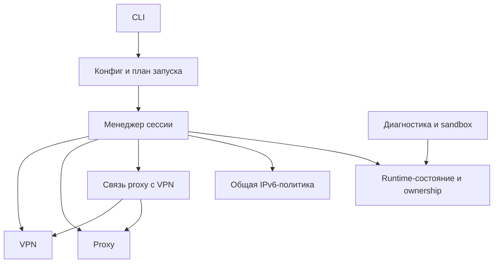

# Задача: независимые режимы VPN и proxy

Статус: основная реализация и автоматические проверки выполнены 2026-10-31.
Пользовательская проверка 2026-10-31 подтвердила работу прежнего конфига и
VPN-only с доступным сервером. При недоступном сервере выявлено ложное сообщение
готовности по одному лишь UP-интерфейсу. Добавлено обязательное ожидание handshake
с VPN_CONNECT_TIMEOUT (default 30 секунд); автоматические проверки прошли.
Повторная ручная приёмка ожидания/таймаута на настоящем AWG и остальные
непроверенные сценарии upstream/GUI остаются открытыми.

Реализовано: VPN_ON/PROXY_ON, модульные границы VPN/proxy/transport, условные
проверки и зависимости, session.state с атомарной записью, три startup-сценария,
наблюдение за компонентами, диагностика и sandbox по активному runtime.
Добавлены тесты режимов и настоящий lifecycle proxy-only с синтетическими
listeners, без вмешательства в сеть хоста. Fault-injection проверяет ошибки
девяти startup-шагов, очистку собственных ресурсов и отсутствие proxy fallback. Документ ниже сохраняет критерии
полной приёмки, включая fault injection и реальные сетевые сценарии.
Расширенная матрица fault-injection для каждого перехода snapshot и отдельный
обязательный kernel/bwrap CI job ещё требуют доработки; текущий Docker сохраняет
явные пропуски bwrap/netns при отсутствии нужных прав.

## Цель и границы

Поддержать VPN-only, proxy-only и совместный запуск. Разделить ответственность
VPN, локального 3proxy с upstream и их совместной работы. Сохранить текущие
гарантии маршрутизации, принадлежности ресурсов, восстановления после аварии
и GUI/sandbox-регрессии.

Первая реализация — текущие Bash/Python и один менеджер одной сессии в выбранном
runtime-каталоге. Состав выбирается конфигом и применяется через restart.
Отдельные команды `vpn start`, `proxy stop`, подключение к чужому VPN, несколько
профилей, Go и фоновая служба — последующие задачи. Прокси сохраняет нынешний
смысл: локальные HTTP/SOCKS-входы пересылают трафик на настроенный upstream.

План установки остаётся отдельной задачей без изменений. Режимы и runtime-контракт
желательно реализовать перед первой устанавливаемой поставкой.

## 1. Пользовательский контракт

```ini
VPN_ON=true
PROXY_ON=true
```

Отсутствующие переключатели означают true: старые конфиги запускают прежнюю
цепочку. Принимать `true/false`, `1/0`, `on/off` в нижнем регистре и сразу
нормализовать в 1/0; пустые и неизвестные значения отклонять.

| VPN_ON | PROXY_ON | Режим и ожидаемое поведение |
|---|---|---|
| true | true | Локальный 3proxy → управляемый VPN → upstream; обязательны маршрут upstream через VPN и guard |
| true | false | Только VPN с ALLOWED_IPS/IPLIST_URLS и DNS; локальных proxy-listeners нет |
| false | true | Локальный 3proxy → upstream через системную маршрутизацию; управляемый VPN не требуется |
| false | false | Невалидный план запуска: config validate/start завершаются ошибкой до изменений состояния и сети |

Системный маршрут в proxy-only может проходить через внешний VPN. Это не
обнаруживается как управляемый VPN и не получает обещаний нашей VPN-защиты.
При совместном режиме ошибка VPN/guard не переводит прокси в proxy-only.

BLOCK_IPV6 остаётся независимой общей политикой с нынешним default `on`.
При `on` правило применяется в любом рабочем режиме и требует nftables/sudo.
Proxy-only с `BLOCK_IPV6=off` может запускаться без VPN-инструментов и sudo;
`run` всё равно требует привилегий для namespace. Отключение VPN не должно
молча переключать BLOCK_IPV6.

Отключённый компонент не требует собственных полей, зависимостей, DNS-запросов
или сетевых действий. Общий синтаксис конфига, неизвестные/повторные ключи и
управляющие символы проверяются всегда. Семантика параметров отключённого
компонента не проверяется; например, VPN_LINK при VPN_ON=false не декодируется.

## 2. Что связано в текущей реализации

| Место | Связность, которую нужно разделить |
|---|---|
| lib/config.sh, lib/validation.sh | VPN_LINK применяется до выбора режима; VPN-поля и PROXY_STRING обязательны одновременно |
| lib/manager.sh | Проверка зависимостей, startup/rollback и healthcheck рассчитаны на одну фиксированную цепочку |
| lib/network.sh | prepare_network_targets разрешает одновременно endpoint и upstream; build_allowed_ips требует PROXY_IPS |
| lib/tunnel.sh | verify_tunnel_routes одновременно проверяет endpoint и маршрут upstream |
| lib/diagnostics.sh | Отсутствие любого компонента считается неисправностью; для проверки runtime загружается текущий конфиг |
| lib/sandbox.sh | run требует одновременно запущенные 3proxy и туннель |
| lib/paths.sh, lib/runtime.sh | Есть отдельные ownership/PID-файлы, но нет версионированной записи выбранного режима сессии |

Менеджер сейчас держит foreground-процесс циклом sleep; это само по себе не
является надзором за здоровьем компонентов. Проверки потери компонентов
нужно проектировать и тестировать явно.

## 3. Предлагаемые границы модулей



Стрелки обозначают использование интерфейсов и данных. VPN и proxy не
импортируют друг друга; блок связи получает подтверждённые параметры обоих.
Для Bash достаточно функций с префиксами и документированных входов/выходов.

| Блок | Ответственность | Предлагаемые файлы |
|---|---|---|
| Конфиг/план | Чтение, defaults, нормализация флагов, условная валидация, выбор шагов и зависимостей | config.sh, validation.sh, новый plan.sh |
| VPN | Endpoint, ключи, обфускация, собственные маршруты/DNS/MTU, AWG lifecycle и проверки туннеля | новый vpn.sh как интерфейс над tunnel.sh и VPN-частью network.sh |
| Proxy | Upstream и его закреплённый IPv4, порты, конфиг 3proxy, PID/listeners, HTTP/SOCKS healthcheck | proxy.sh |
| Связь proxy с VPN | Дополнительные маршруты к upstream, проверка прохода через конкретный туннель, обязательный guard | новый transport.sh и существующий guard.sh |
| Общая политика | Глобальное ограничение IPv6, установка и снятие собственной таблицы | ipv6.sh |
| Сессия | Выбор шагов, блокировки, startup, наблюдение, rollback, stop/restart | manager.sh |
| Состояние | Версионированные параметры активной сессии и фазы запуска, безопасное чтение/запись | новый session.sh, paths.sh, runtime.sh |
| Потребители состояния | Проверка включённых компонентов, sandbox через активный proxy endpoint | diagnostics.sh, sandbox.sh |

network.sh оставляет общие операции IPv4/CIDR и разрешения имён. VPN-сборка
AllowedIPs относится к VPN-блоку. Общие функции не запускают оба компонента
неявно. Существующие низкоуровневые функции и файлы можно сохранять за фасадами;
массовое переименование не является целью.

### Явные интерфейсы

- VPN: validate/deps, prepare endpoint, build routes, start, inspect, stop.
  Сборка маршрутов принимает дополнительные IPv4/CIDR аргументами; не читает
  PROXY_HOST и не вызывает разрешение upstream при их отсутствии.
- Proxy: validate/deps, prepare upstream, start, inspect, healthcheck, stop.
  Получает подготовленный upstream и не принимает решение о VPN.
- Transport: подготовить дополнительные маршруты из закреплённых upstream-IP;
  после запуска VPN проверить маршрут, установить/проверить guard, затем
  разрешить запуск proxy. Снятие guard отдельно от остановки VPN/proxy.
- Session/manager: единственное место выбора компонентов и порядка действий.
  Компонентные lifecycle-функции возвращают результат; решение о завершении
  сессии и rollback принимает менеджер.

Данные подготовленного режима неизменны в пределах запуска. Параметры,
вычисленные из runtime, не подменяются повторным чтением конфига. Глобальные
переменные Bash остаются возможны, но у каждого набора есть явный владелец;
чтение посторонних CONFIG_* не заменяет контракт функции.

## 4. Конфигурация, зависимости и проверки

Последовательность загрузки: прочитать безопасный KEY=value → применить defaults
переключателей → нормализовать их → при включённом VPN применить VPN_LINK →
проверить общую политику и только выбранные компоненты → построить план.
Эта стадия выполняется до записи manager PID, установки firewall и запуска
компонентов. config validate остаётся офлайн и не создаёт каталоги.

- VPN требует только собственные ключи/endpoint/interface, параметры AWG и
  маршрутов; resolvconf нужен при используемом DNS. PROXY_STRING не требуется.
- Proxy требует upstream, HTTP/SOCKS-порты и свои настройки; AWG-поля,
  ALLOWED_IPS, IPLIST_URLS и DNS туннеля не используются.
- Общие зависимости проверяются по операциям: Python нужен для VPN_LINK,
  агрегации маршрутов, проверки guard и sandbox-forwarder; ip/sudo/nft — для
  выбранных сетевых действий. Не требовать всё из старого check_deps всегда.
- Подготовка endpoint и upstream разделяется. В VPN-only недоступный upstream
  из неиспользуемой секции не мешает запуску; в proxy-only не разрешается endpoint.
- При полном VPN прежняя семантика 0.0.0.0/0 и проверки fwmark сохраняются.
  В совместном режиме маршрут к закреплённому upstream обязателен и при
  выборочном ALLOWED_IPS. VPN-only не зависит от существования PROXY_IPS.

## 5. Runtime-контракт и восстановление

Ввести приватный session-файл с версией формата, session ID, идентичностью
менеджера, нормализованными флагами VPN/proxy/IPv6 и фазой жизненного цикла.
Безопасные фактические параметры (interface, pinned upstream, активные порты)
сохранять явно либо читать через интерфейсы соответствующих ownership/runtime
файлов. Секреты не дублировать в session-файле и не выводить в диагностике.

- Различать намерение запустить компонент и подтверждённый созданный ресурс.
  Intent/ownership сохраняются до опасного действия; ready — только после проверок.
- Запись атомарная, права 600, проверенные ключи/значения и версия. Никакого
  source/eval runtime-файлов. Snapshot не заменяет проверку PID/boot ID/ifindex
  и принадлежности nftables/netns.
- stop и повторный stop работают без конфига, даже после удаления/повреждения
  конфига или смены VPN_ON/PROXY_ON. Очищаются подтверждённые ресурсы сессии.
- Для status/diagnose/run источником активного режима служит runtime.
  Разница с конфигом показывается как «ожидает restart», а не меняет режим
  или отключает защиту работающей сессии.
- Snapshot удаляется только после завершённой очистки. Ошибка очистки сохраняет
  данные и оставшиеся правила, чтобы последующий stop мог продолжить.
- Зафиксировать единый порядок блокировок: sandbox → manager там, где нужны обе.
  Не ждать завершения менеджера, удерживая lock, нужный ему для cleanup.
  Запись и переходы состояния сериализуются; параллельные start/stop/run
  не могут смешать snapshot одной попытки с ownership другой.
- Перед обновлением требуется stop прежней версией. Новый stop сохраняет
  поддержку существующих ownership-записей для восстановления. Отсутствующий
  snapshot у старого/частичного запуска обозначается как legacy/incomplete;
  отсутствующий ресурс нельзя интерпретировать как намеренно отключённый.
  Новый start отказывает при любом неочищенном legacy-состоянии.

## 6. Порядок запуска, остановки и отказов

Общий старт: офлайн-проверка плана → lock/проверка оставшегося состояния →
создание сессии → проверка зависимостей и подготовка адресов → IPv6-политика.
После этого выполняется выбранная последовательность:

| Режим | Шаги запуска после подготовки |
|---|---|
| VPN-only | Собрать AllowedIPs → поднять VPN → проверить endpoint/маршруты/принадлежность |
| Proxy-only | Проверить порты → запустить 3proxy → проверить listeners и HTTP/SOCKS |
| VPN + proxy | Добавить upstream-маршруты → поднять VPN → проверить endpoint и upstream route → установить guard → запустить 3proxy → проверить listeners и HTTP/SOCKS |

Proxy env печатается только при включённом proxy. VPN-only не запускает curl
через отсутствующие listeners. STARTUP_HEALTHCHECK остаётся проверкой proxy;
в VPN-only он неприменим и не делает запуск зависимым от upstream. Структурные
проверки VPN обязательны; живой handshake и сетевой трафик оцениваются отдельно,
без обещания, что наличие интерфейса доказывает доступность сервера.

Модель остановки: завершить/проверить отсутствие активного sandbox → остановить
proxy, если создан → остановить VPN и его DNS, если создан → снять transport
guard → снять IPv6-политику последней → удалить snapshot. Пропускаются только
отсутствующие подтверждённые ресурсы; при сомнительной принадлежности — ошибка.
Если proxy не удалось остановить, связанные защиты остаются. При незавершённом
удалении VPN/DNS также сохраняются состояние и оставшаяся защита.

Rollback старта действует только на созданные этой попыткой ресурсы. Сигналы
не должны прерывать сохранение ownership посередине опасного действия.
Менеджер наблюдает только за выбранными компонентами: при подтверждённой
потере процесса proxy, собственного туннеля или обязательного guard фиксирует
ошибку и начинает контролируемую остановку. Недоступность проверки не означает
«ресурс отсутствует» и не разрешает снятие защиты. Отсутствие свежего handshake
на простаивающем туннеле само по себе не запускает аварийную остановку.

Guard должен блокировать выход upstream вне VPN независимо от интервала
наблюдения менеджера. При падении VPN не допускается автоматический proxy-only.
Новый режим VPN-only сохраняет нынешнюю границу: полного IPv4 kill switch для
всего хоста эта задача не добавляет.

restart сначала проверяет новый конфиг/план, затем останавливает старую сессию
по runtime и запускает новую. Невалидные переключатели не должны сначала
выключать исправную старую сессию. Ошибка запуска нового режима после stop
сообщается явно; автоматического возврата к иному режиму нет.

## 7. Диагностика, test и sandbox

- status/diagnose различают DISABLED, STARTING, RUNNING, FAILED и UNKNOWN
  компонентов. Отключённый proxy или VPN не добавляет ошибку.
- Отдельно показывать маршрут proxy: управляемый VPN с проверенной защитой
  либо системная маршрутизация без такого обещания. BLOCK_IPV6 выводится
  отдельной строкой.
- Сохранить коды 0 — проверено, 1 — неисправность, 2 — неполная/неопределённая
  проверка, 3 — остановлено. Для первого этапа сохранить существующую трактовку
  BLOCK_IPV6=off как неполной защиты (код 2), явно объясняя её в выводе.
- test сохраняет нынешний смысл проверки upstream. При выключенном proxy
  возвращает 2 с объяснением неприменимости, не пытаясь читать PROXY_STRING.
- run и GUI launcher требуют активный proxy. В proxy-only сохраняются netns
  без default route, forwarder и filesystem-изоляция; проверка собственного VPN
  применяется только к совместному runtime-режиму.
- В VPN-only run отказывает до создания netns/forwarder. Поддержка sandbox с
  прямым доступом в VPN — отдельная задача с новой сетевой политикой.
- Изменение конфига после start не меняет активные proxy-порты, режим run,
  обязательность guard или предмет диагностики. При удалённом конфиге status
  проверяет доступное runtime-состояние и не требует VPN/upstream-секретов.
- Сохраняются GUI-маскирование runtime, XAUTHORITY-bind, корректный HTTP_PROXY
  и работоспособность без XDG_SESSION_TYPE. Укрепление sandbox из отдельного
  плана локальной изоляции не считается автоматически выполненным.

## 8. Этапы реализации и критерии готовности

### Этап A — зафиксировать поведение и тестовые сценарии

Обновить справочник и config.example: флаги/defaults, таблица режимов,
BLOCK_IPV6, применимость test/run/healthcheck. Подготовить fixtures трёх режимов
и спецификацию runtime/миграции. Сохранить исходные combined-регрессии.

**Готово:** для каждой команды определено поведение во всех режимах и при
редактировании конфига работающей сессии; непрояснённых автоматических переходов нет.

### Этап B — выделить компоненты при прежнем совместном поведении

Разделить подготовку адресов, проверки маршрутов, зависимости и healthcheck;
добавить VPN-фасад и transport-блок. Убрать обращения proxy к VPN-параметрам,
а из VPN — неявную зависимость от upstream. Менеджер собирает combined-сценарий
через явные функции, пока пользовательские режимы ещё не включены.

**Готово:** весь прежний набор проходит; VPN-подготовка тестируется без
PROXY_HOST, proxy-подготовка — без VPN-ключей; guard вызывается только оркестратором.

### Этап C — добавить план и session-state

Реализовать нормализацию переключателей и условную валидацию, версионированную
сессию, обновление фаз и восстановление старых ownership-записей. На этом этапе
новые режимы можно тестировать внутренне; публично включать их после этапа D.

**Готово:** валидатор не требует выключенные секции; unknown/duplicate keys
отклоняются; выключенный VPN_LINK не декодируется; stop не читает конфиг;
повреждение snapshot не разрешает захват или удаление чужого ресурса.

### Этап D — включить три режима и их lifecycle

Реализовать план запуска/rollback/остановки, предварительную проверку restart
и наблюдение за выбранными компонентами. Обеспечить независимость общей
IPv6-политики от VPN_ON и отсутствие автоматического обхода VPN.

**Готово:** три режима запускаются и завершаются; обе false не меняют runtime
и сеть; proxy-only с IPv6 off не вызывает sudo/awg/ip/nft; VPN-only не вызывает
3proxy, не разрешает upstream и не создаёт runtime-копии его секретов; SIGTERM/ошибки
каждого шага сохраняют безопасное восстанавливаемое состояние.

### Этап E — переключить диагностику и sandbox на runtime

Разделить inspect-функции VPN/proxy/transport; адаптировать status/diagnose/test,
run и GUI. Показать явно выбранный режим, disabled-компоненты и гарантии защиты.

**Готово:** VPN-only не даёт ложного FAIL из-за proxy; proxy-only — из-за VPN;
run работает с proxy-only; run без proxy отказывает до создания ресурсов;
после изменения/удаления конфига активные проверки используют прежний snapshot.

### Этап F — интеграционная приёмка и документация

- Mock-тесты: три режима, четыре сочетания флагов, варианты bool, defaults,
  отсутствующие зависимости, пропуск выключенных секций и опасных вызовов.
- Fault injection: запись intent/ready, sudo/nft/awg, занятые порты, DNS,
  падение proxy, удаление/подмена туннеля, недоступная инспекция, ошибки cleanup,
  сигналы между шагами и повторный stop после SIGKILL.
- Изолированные kernel-тесты: combined не выпускает upstream вне VPN;
  proxy-only достигает upstream системным маршрутом без transport guard;
  VPN-only устанавливает нужные маршруты без proxy; IPv6 on/off во всех режимах;
  чужие ресурсы и firewall-правила сохраняются.
- Реальные bwrap-тесты: proxy-only/combined, HTTP/SOCKS, исходный cwd,
  секретные runtime-файлы, GUI env и XAUTHORITY. Все изменения сети тестируются
  в изолированной среде. Требуемые security-прогоны не засчитываются при SKIP.
- Совместимость: старый конфиг без флагов, legacy runtime, конфиг изменён во
  время работы, restart между всеми тремя режимами, включая failed restart.
- Ручная приёмка с настоящими AWG/3proxy: VPN-only, proxy-only, combined и GUI;
  отсутствие в тестовом окружении нужных компонентов описывается как ограничение.

**Готово:** текущие и новые тесты, ShellCheck/actionlint и kernel-наборы проходят;
README/REFERENCE соответствуют режимам, а сохранённые runtime-секреты не видны
GUI-приложению. Код и тесты каждого этапа идут вместе, без ожидания этапа F.

## Порядок поставки

A → B → C → D → E → F. Этап B — отдельный рефакторинг с сохранением поведения;
C–E образуют законченную пользовательскую возможность и принимаются вместе.
Следующим этапом может идти установка. Архитектурные границы затем используются
при переносе на Go, без требования перенести в Go каждую Bash-функцию один к одному.

## Связанные планы

- [Установка](INSTALLATION.md) — её описание оставлено без изменений.
- [Go](GO_MIGRATION.md) — общий CLI и отдельные системные операции.
- [Локальная изоляция](LOCAL_ISOLATION.md) — независимый план усиления sandbox;
  согласовать ownership/session-контракт, чтобы не вводить две конкурирующие модели.
